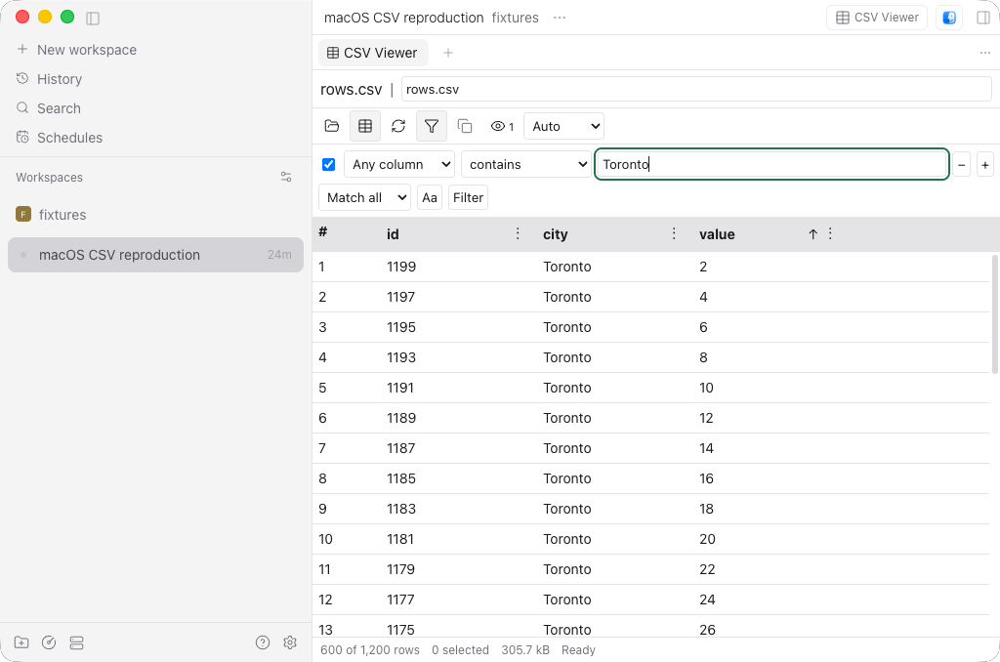
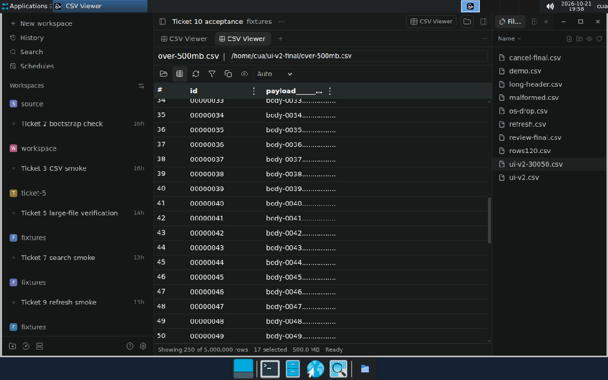

# CSV Viewer

[](https://github.com/hoon0422/paseo-csv-viewer/actions/workflows/ci.yml)

A read-only CSV and TSV viewer for [Paseo](https://paseo.sh) that opens multi-gigabyte files without loading them into memory. Open it from the Command Center or the workspace header. Then enter a path, choose a local file, or drop a file from Paseo Files or your desktop file manager anywhere on the panel.



## Built for large files

CSV Viewer is made for files that a text editor or spreadsheet struggles to open. The first rows appear almost at once, and the whole file is ready to sort and filter in seconds to minutes.

| Measured on an Apple M4 Pro | 500 MB, 8.8 million rows | 5.4 GB, 87 million rows |
| --- | --- | --- |
| First rows on screen | 0.016 s | 0.017 s |
| Whole file ready to sort and filter | 5.7 s | 62 s |
| First screen after sorting the whole file | 0.6–1.6 s | 6.3–7.7 s |
| Next 200 rows while scrolling a sorted or filtered view | ≤ 0.04 s | ≤ 0.48 s |
| Peak memory | 1.5 GB | 6.0 GB |
| Temporary disk | 0.3 GB | 3.2 GB |

Performance is guaranteed for files up to 500 MB: the first sorted screen within 2 seconds and each scrolled page within 0.2 seconds. Larger files open fully after you confirm a size warning; they work, but no timing is promised. See [ADR 0003](docs/adr/0003-performance-guaranteed-up-to-500-mb.md) and the [benchmark report](reports/ui-v2/final/native-report-500mb.md).



How it stays fast:

- **Preview first.** The first 50 rows appear while the rest of the file is checked and prepared in the background. You can scroll and select rows during preparation.
- **Read in place, never uploaded.** The file is read where it is, and dropping a file passes its path, not its contents. The original file is never modified.
- **A disk-backed engine.** A [DuckDB](https://duckdb.org) database in a private temporary directory holds the prepared rows. Sorts that do not fit in memory spill to disk instead of failing.
- **Only what you see.** The app loads 200 rows at a time as you scroll. Search, filters and sorting always cover the whole file, including hidden columns and rows you have not scrolled to.
- **Cancellable and replaceable.** A new source, a header change or a closed panel stops the work in progress and deletes its temporary files.

## Features

- UTF-8 CSV and TSV. The first record is the header by default; you can treat it as data instead.
- Infinite scrolling with one-line rows that expand to show long values.
- Sort by any column in Auto, Numeric or Text order. Auto detects numeric columns; Numeric compares exact values.
- Filter with rules: any or a named column, contains, equals, regular expressions, numeric comparisons and ranges, match all or any, and optional case sensitivity.
- Hide, resize and auto-fit columns.
- Select rows with click, Shift and Ctrl or Command, and copy them as TSV in the current order, visible columns only. Double-click a cell to copy its value.
- Strict parsing: a record with the wrong number of fields is reported with its line number.
- If the source file changes, the current table stays on screen with a notice until you press Refresh.

## Compatibility and data access

CSV Viewer requires Paseo **0.12.0** exactly, on both the app and the daemon. Node.js and npm must be on the daemon's `PATH`. The current version was tested with the official 0.12.0 desktop app and daemon on:

- Ubuntu 24.04 x86_64 ([UI acceptance](reports/ui-v2/README.md), [child process recheck](reports/linux-21/README.md)).
- macOS 26 arm64 ([acceptance](reports/macos-v2/README.md)).

An earlier version also passed on Windows Server 2022 x64 ([report](reports/platform-acceptance/README.md)). The current version has not been retested on Windows and has a known path bug there ([#23](https://github.com/hoon0422/paseo-csv-viewer/issues/23)).

All DuckDB work runs in a child `node` process on the daemon machine, on every OS. The official macOS Paseo app's Hardened Runtime refuses to load DuckDB's native library into the daemon itself ([ADR 0004](docs/adr/0004-duckdb-node-child.md)). Panels share one child, and closing the last panel stops it. If the child crashes, its sessions fail, their temporary files are removed, and the next open starts a fresh child.

External file drops and the local file picker work only when the panel's host is the desktop app's own daemon. Make sure the daemon's temporary disk has room for the prepared rows, which can take more than half the size of the source file. Like every Paseo plugin, CSV Viewer is trusted code with the daemon user's file, process and network access.

Paseo 0.12.0 does not bundle DuckDB's native binary into its plugin server bundle. CSV Viewer finds the installed DuckDB package through the `csv-viewer` entry in `PASEO_HOME/config.json`, so keep the default plugin ID. Paseo Files drag data and desktop file paths also use internal Paseo 0.12.0 interfaces. Later Paseo releases need a separate compatibility check before the manifest range is widened.

## Install

Install from GitHub on a Paseo daemon:

```bash
paseo plugin install github:hoon0422/paseo-csv-viewer
```

The manifest runs `npm ci --omit=dev --ignore-scripts` from the committed lock to install DuckDB's native runtime.

## Development

```bash
npm ci
npm run check   # typecheck, and confirm server/child.cjs matches its source
npm test        # rebuilds server/child.cjs, then runs the suite
```

`server/child.cjs` is a committed bundle of the child process, built with esbuild, a development-only dependency. Run `npm run build` after changing the child's source. Outside Paseo, unset an inherited `PASEO_HOME` so DuckDB is loaded from the checkout instead of an installed plugin.

CI runs the same checks on Ubuntu and macOS for every pull request and every push to `main`. Windows is tracked in [#23](https://github.com/hoon0422/paseo-csv-viewer/issues/23).
